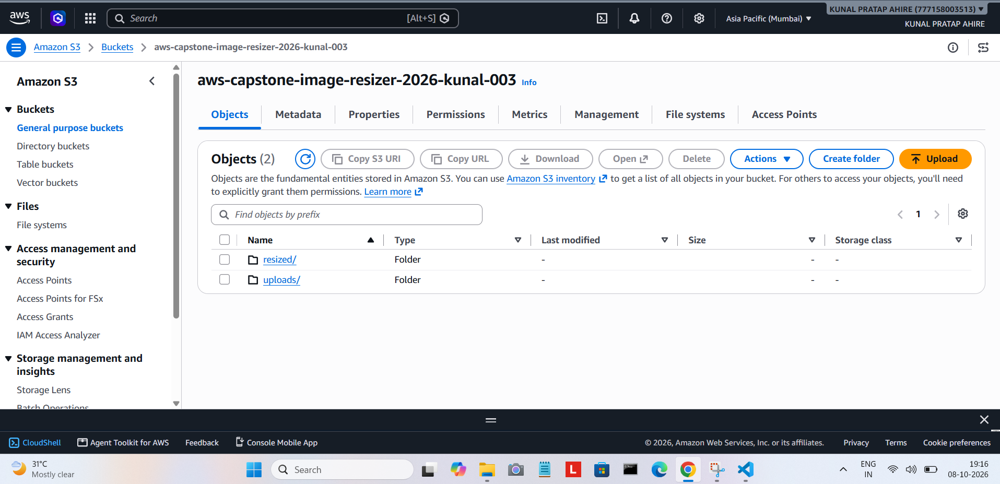
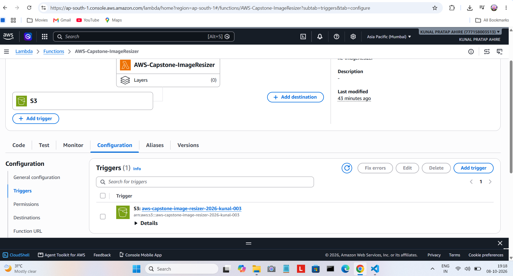
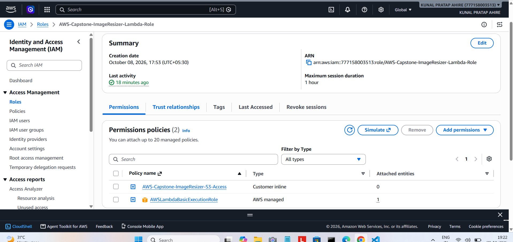
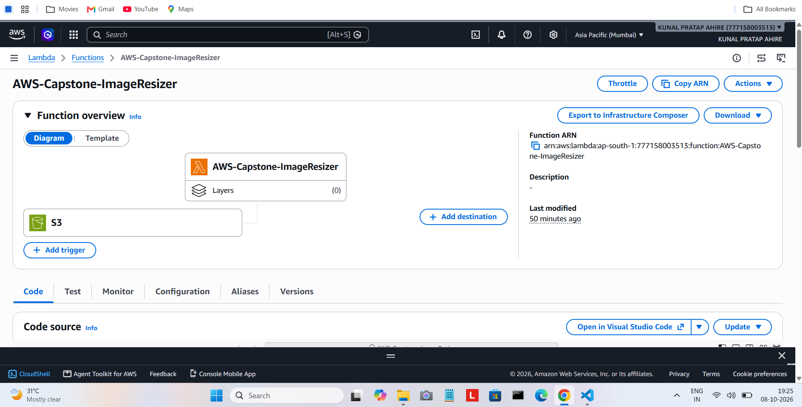
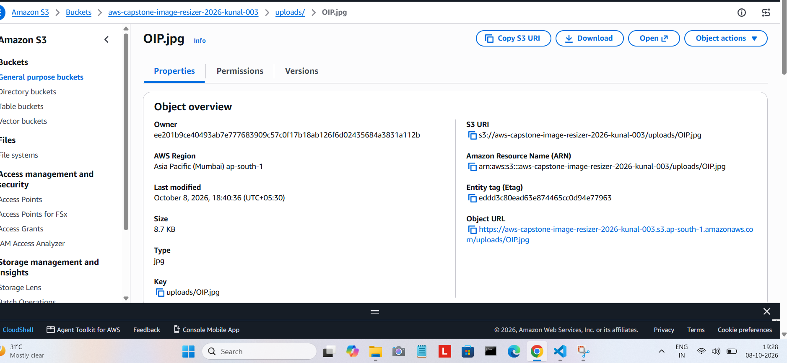
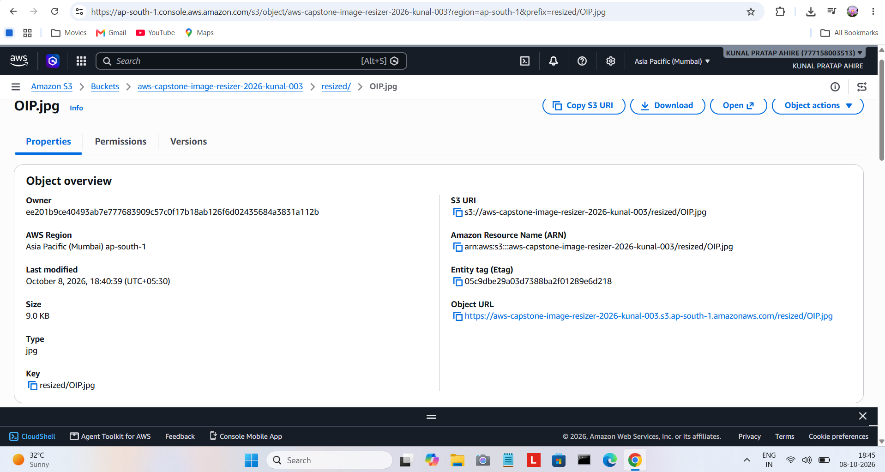
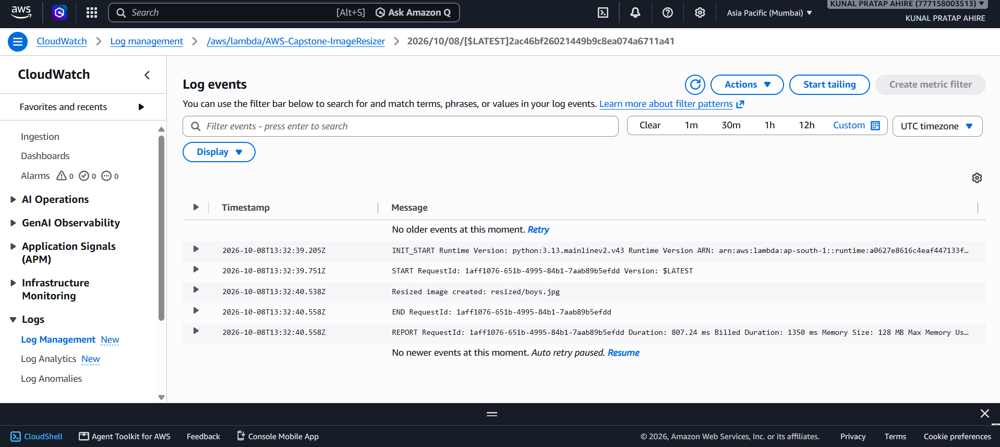

# Serverless Image Resizer using AWS

## 1. Project Overview

In this project, I built a simple **Serverless Image Resizer** using AWS.

The main idea is that when I upload an image to an S3 bucket, AWS automatically triggers a Lambda function. The Lambda function resizes the image using Python and Pillow and saves the resized image in another folder in the same S3 bucket.

I used AWS Lambda, Amazon S3, IAM, and CloudWatch to build and test the complete workflow.

---

## 2. Objective

The main goal of this project was to learn how to automatically process an image using AWS without running a server all the time.

The system should:

* Accept an image uploaded to S3.
* Automatically trigger Lambda.
* Resize the image using Python.
* Save the resized image to S3.
* Show the Lambda execution in CloudWatch.

---

## 3. AWS Services Used

### Amazon S3

I used S3 to store both the original and resized images.

I created two folders:

```text
uploads/
resized/
```

The original image goes into `uploads/`, and the resized image is saved in `resized/`.

### AWS Lambda

Lambda runs my Python code automatically when a new image is uploaded to S3.

I used **Python 3.13** as the Lambda runtime.

### AWS IAM

I created an IAM role for Lambda and gave it only the permissions needed for this project.

### Amazon CloudWatch

I used CloudWatch to check whether Lambda was running successfully and to view the execution logs.

---

## 4. How the Project Works

The complete flow is:

```text
User
  |
  | Upload Image
  v
Amazon S3
uploads/
  |
  | S3 Trigger
  v
AWS Lambda
Image Resizer
  |
  | Resize using Pillow
  v
Amazon S3
resized/
  |
  v
Resized Image
```

CloudWatch is also used to check the Lambda execution.

---

## 5. Project Workflow

Here is what happens when I upload an image:

1. I upload an image to the `uploads/` folder.
2. S3 detects that a new image has been uploaded.
3. S3 automatically triggers the Lambda function.
4. Lambda reads the image from S3.
5. Python and Pillow resize the image.
6. Lambda creates a new resized image.
7. The resized image is saved in the `resized/` folder.
8. CloudWatch stores the Lambda execution logs.

---

## 6. S3 Bucket

I created the following S3 bucket:

```text
aws-capstone-image-resizer-2026-kunal-003
```

AWS Region:

```text
ap-south-1
```

Inside the bucket, I created:

```text
uploads/
resized/
```

The bucket was kept private and S3 server-side encryption using SSE-S3 was enabled.

---

## 7. Lambda Function

Lambda function name:

```text
AWS-Capstone-ImageResizer
```

Runtime:

```text
Python 3.13
```

Handler:

```text
lambda_function.lambda_handler
```

The Lambda function uses the **Pillow** library to resize images.

The maximum resize size used in the project is:

```text
800 x 800
```

The image aspect ratio is maintained while resizing.

---

## 8. IAM Role

I created the following IAM role for Lambda:

```text
AWS-Capstone-ImageResizer-Lambda-Role
```

The role has the required permissions to:

* Read images from the `uploads/` folder.
* Write resized images to the `resized/` folder.
* Write logs to CloudWatch.

I used the AWS managed policy:

```text
AWSLambdaBasicExecutionRole
```

for CloudWatch logging.

I also created an S3 access policy for this project.

---

## 9. S3 Trigger

I connected the S3 bucket to the Lambda function using an S3 trigger.

Bucket:

```text
aws-capstone-image-resizer-2026-kunal-003
```

The trigger is configured for object creation events.

The prefix used is:

```text
uploads/
```

This means that when an image is uploaded inside `uploads/`, Lambda is automatically triggered.

---

## 10. Python Code

The main Lambda file is:

```text
lambda_function.py
```

The code uses:

* `boto3` to communicate with S3.
* `Pillow` to open and resize images.
* `BytesIO` to handle the image in memory.
* `unquote_plus` to correctly read the S3 object key.

The image is resized to a maximum size of `800 x 800` while keeping its original aspect ratio.

The resized image is then saved using the same file name inside the `resized/` folder.

---

## 11. Pillow Dependency

For image processing, I used:

```text
Pillow==12.3.0
```

The Pillow package was included in the Lambda deployment ZIP file so that Lambda could use it while processing images.

The dependency is also listed in:

```text
requirements.txt
```

---

## 12. Testing the Project

I tested the project by uploading images to the S3 `uploads/` folder.

### First Test

Original image:

```text
uploads/OIP.jpg
```

Lambda created:

```text
resized/OIP.jpg
```

### Second Test

I uploaded another image:

```text
uploads/boys.jpg
```

Lambda created:

```text
resized/boys.jpg
```

This confirmed that the S3 trigger and Lambda function were working correctly.

---

## 13. CloudWatch Test

After the second test, I checked the Lambda logs in CloudWatch.

The log showed:

```text
Resized image created: resized/boys.jpg
```

I also saw the normal Lambda:

```text
START
END
REPORT
```

messages.

This confirmed that the Lambda function completed successfully.

---

## 14. Screenshots

### 01 — S3 Bucket



This screenshot shows the S3 bucket and the `uploads/` and `resized/` folders.

### 02 — Lambda Function



This screenshot shows the Lambda function created for the project.

### 03 — IAM Role



This screenshot shows the IAM role and its permissions.

### 04 — Lambda Trigger



This screenshot shows the S3 trigger connected to the Lambda function.

### 05 — Original Image



This screenshot shows the original image uploaded to the `uploads/` folder.

### 06 — Resized Image



This screenshot shows the resized image created inside the `resized/` folder.

### 07 — CloudWatch Logs



This screenshot shows the Lambda execution logs and confirms that the image was resized successfully.

---

## 15. Project Structure

```text
Project-5-Serverless-Image-Resizer/
│
├── lambda_function.py
├── requirements.txt
├── README.md
│
└── screenshots/
    ├── 01-s3-bucket.png
    ├── 02-lambda-function.png
    ├── 03-iam-role.png
    ├── 04-lambda-trigger.png
    ├── 05-original-image.png
    ├── 06-resized-image.png
    └── 07-cloudwatch-logs.png
```

---

## 16. How to Run the Project

To use this project:

1. Create the S3 bucket.
2. Create the `uploads/` and `resized/` folders.
3. Create the Lambda function.
4. Create the Lambda IAM role.
5. Add the required S3 and CloudWatch permissions.
6. Upload the Lambda ZIP package.
7. Configure the S3 trigger.
8. Upload an image to the `uploads/` folder.
9. Wait for Lambda to process the image.
10. Open the `resized/` folder and check the new image.
11. Check CloudWatch Logs to confirm the Lambda execution.

---

## 17. Security

I followed some basic security practices while building this project.

* I kept the S3 bucket private.
* I used an IAM role for Lambda.
* I gave Lambda only the required S3 permissions.
* I added CloudWatch logging permissions.
* I used S3 server-side encryption.
* I did not put AWS access keys or secret keys in the project files.
* No AWS credentials are uploaded to GitHub.

---

## 18. What I Learned

While working on this project, I learned how different AWS services can work together.

I learned:

* How S3 stores objects.
* How an S3 upload can trigger Lambda.
* How to write a Lambda function using Python.
* How to use Pillow for image processing.
* How to package Python libraries for Lambda.
* How IAM roles and permissions work.
* How to check Lambda execution using CloudWatch.
* How serverless applications can automatically process events without keeping a server running.

---

## 19. Real-World Use

A system like this can be useful when a website or application receives many images from users.

For example, an application can automatically create smaller images for:

* Profile pictures
* Product images
* Website thumbnails
* Social media images
* Image galleries

Instead of manually resizing every image, the process can happen automatically after the upload.

---

## 20. Conclusion

In this project, I built a serverless image resizing system using AWS.

The complete workflow worked successfully:

```text
S3 Upload
    ↓
S3 Trigger
    ↓
Lambda
    ↓
Pillow Image Resize
    ↓
S3 Resized Image
    ↓
CloudWatch Logs
```

This project helped me understand how AWS S3, Lambda, IAM, and CloudWatch can be connected together to build a simple event-driven application.
